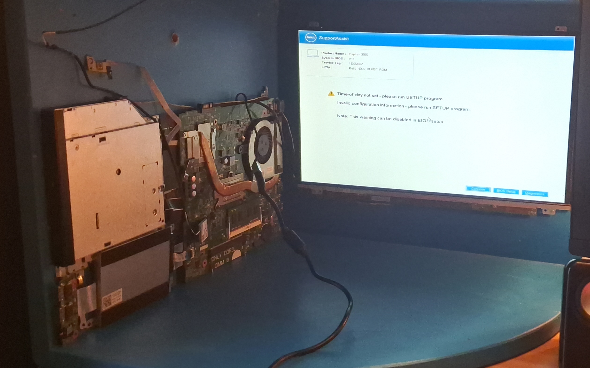

# Proxmox Homelab

A home server built from an old Dell laptop, taken apart and mounted on a shelf. I use it to practise Linux and Windows administration and basic security testing.

## Hardware
- Dell motherboard and screen, mounted on a shelf
- [1tb, backup. 500gb base OS.]

## Software
- **Proxmox VE** as the hypervisor
- **Debian VM** running a database
- **Windows and Linux VMs** used as practice targets
- **Backup storage** for the VMs

## What I learned
- Network configuration: troubleshooting broken connectivity between the host and VMs
- Tailscale: set it up for remote access to the lab
